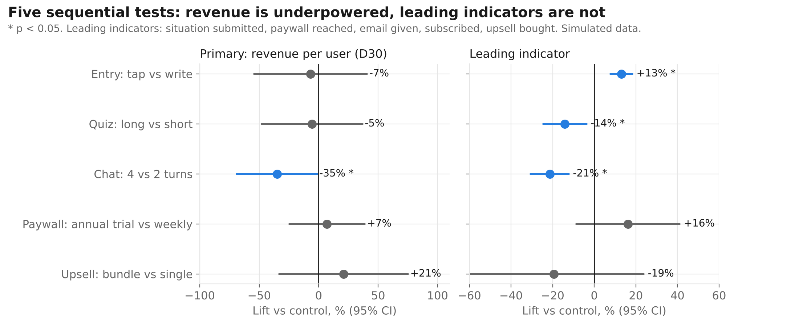

# Memo 1. Five tests in six months: what we learned and what we decided

*Simulated data, June–November 2026. Unit = anonymous device, 50/50 by GrowthBook hash. Numbers from `scripts/analyse_v3.py`.*

## TL;DR

* At ~300 visitors a day, **revenue per visitor cannot be read in a 4-week test**: the minimum detectable effect is 53–71%. Every funnel test was decided on a pre-registered leading indicator, with revenue as a guardrail and a 5% holdout to check it after shipping.
* **Shipped:** entry-mode = tap (+13% situations submitted, p < 0.001) and paywall-model = annual trial (business call on cash and payback, holdout still running).
* **Not shipped:** quiz-length = long (−14% paywall reach, p = 0.008) and chat-length = 4 turns (−21% emails, −35% revenue per visitor, p = 0.04).
* **Not called:** upsell-offer. 300 upsell viewers in five weeks can't separate the arms, so the test keeps running.

## Read-out

| Test | Window | n (C / T) | SRM p | Leading indicator | Revenue per visitor, D30 | Decision |
|---|---|---|---|---|---|---|
| Entry: tap vs write | Jun 1–29 | 3,289 / 3,248 | 0.61 | Situation submitted 45.8% → 51.8% (+13%, p < 0.001) | −7% [−54%, +41%], MDE 71% | **Ship tap**, 5% holdout |
| Quiz: long vs short | Jul 1–29 | 3,677 / 3,831 | 0.08 | Paywall reached 15.2% → 13.0% (−14%, p = 0.008) | −5% [−48%, +37%], MDE 61% | **Keep short** |
| Chat: 4 vs 2 turns | Aug 3–31 | 4,301 / 4,314 | 0.89 | Email given 16.3% → 12.8% (−21%, p < 0.001) | −35% [−69%, −1%], p = 0.04 | **Keep 2 turns** |
| Paywall: annual trial vs weekly | Sep 1–Oct 13 | 1,104 / 1,137 paywall viewers | 0.49 | Subscribed 10.6% → 12.3% (+16%, p = 0.20) | +7% [−25%, +39%] per viewer, MDE 42% | **Ship annual trial**, 5% holdout |
| Upsell: bundle vs single | Oct 14–Nov 18 | 149 / 154 upsell viewers | 0.77 | Bought 20.1% → 16.2% (p = 0.38) | +21% [−33%, +75%] per viewer | **Keep running** |

## What each decision rests on

**Entry mode.** The variant removes the hardest step (an empty text box) and the effect on that step is large and certain. Revenue can't confirm it at this traffic, so the 5% holdout is the confirmation. After 60 days the holdout had 852 users. The shipped version was ahead on revenue per visitor (+57%, p = 0.18), which is directionally consistent but still noisy. Decision stands.

**Quiz length.** The long quiz was meant to raise conversion on the paywall by building more context. The cost is certain (fewer people reach the paywall) and the benefit isn't visible. Not shipped.

**Chat length.** This is the clearest result of the six months: four turns lose people inside the chat, and the people who leave are the ones who would have given an email. More value in the product doesn't help if it costs completion. It is the only test where revenue itself moved significantly.

**Paywall model.** This one is shipped as a business decision, and the memo says so plainly. The evidence on conversion is positive but not significant at 2,200 viewers. Annual trials bring cash forward: blended CAC went from $53 in September to $42–43 in October and November, while D30 LTV per subscriber held at ~$36. The cost of being wrong is small and reversible, and the holdout runs until December 12. *Re-check:* refunds and trial-to-paid in the holdout before the annual renewals come due next September.

**Upsell.** Five weeks gave 300 viewers. To detect a 20% difference in revenue per viewer we would need about 3,000 viewers in total. Options: keep running (almost a year at today's volume), test a bigger change, or accept a decision on judgement. The recommendation is the second.

## Method notes

* **SRM** (sample ratio mismatch) is checked first in every read-out. None of the five failed (all p > 0.05).
* **Regression adjustment** on pre-assignment covariates (channel, angle, OS, country, week) cut variance by less than 1%. New visitors carry no history, so these covariates predict little. CUPED is planned for in-app tests, where 4 weeks of prior activity exist.
* **Power.** The MDE column is the smallest lift the test could detect with 80% power at the sample it got. This is the number to compute before launch: it is why leading indicators are the primary metrics for funnel tests here.
* **Sequential, not parallel.** One test at a time means no interaction effects, but only about 8 tests a year. At 2–3× the traffic, the roadmap should run non-overlapping tests in parallel on different funnel stages.
