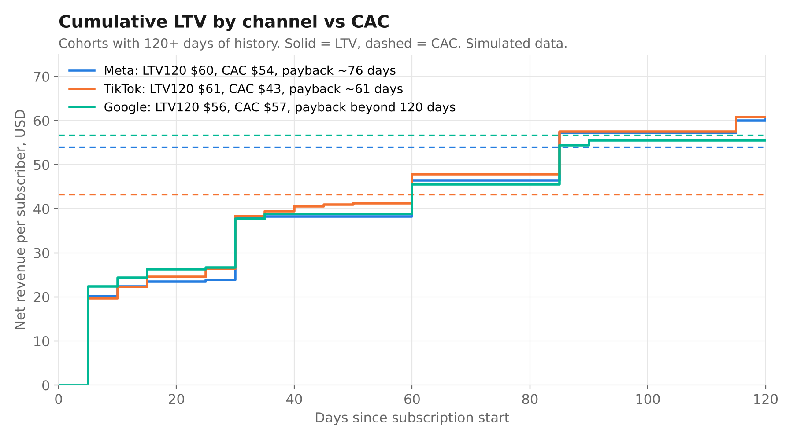

# Memo 2. Unit economics by channel: where the next dollar should go

*Simulated data, June–November 2026. LTV = net revenue per subscriber (first charge, trial conversions, renewals, upsells, minus refunds) from the Stripe webhook events; CAC = ad spend ÷ new subscribers; spend from `data/v3/ad_spend.csv`, joined on `utm_campaign`.*

## TL;DR

* **TikTok has the best economics despite the worst conversion.** Its visitors convert at 1.3% vs 1.7% on Meta, but cost 40% less, so CAC is $43 vs $54 and payback is ~61 days vs ~76.
* **Google converts best (2.6%) and pays back worst.** CAC is $57, and LTV only reaches $56 by day 120. At today's bids Google doesn't pay back within four months.
* **Recommendation:** move 15–20% of the Google budget to TikTok angles that already convert, bring Google cost per visitor below ~$1.40, its 120-day break-even (today $1.45), and re-read in 6 weeks.

## Numbers

| Channel | Visitors | Subscribers | CVR | Spend | CAC | LTV D30 | LTV D90 | LTV D120 | Payback | ROAS D30 |
|---|---|---|---|---|---|---|---|---|---|---|
| Meta | 32,310 | 551 | 1.71% | $29,747 | $54 | $37 | $60 | $60 | ~76 d | 0.68 |
| TikTok | 13,286 | 169 | 1.27% | $7,303 | $43 | $36 | $59 | $61 | ~61 d | 0.84 |
| Google | 6,620 | 169 | 2.55% | $9,586 | $57 | $36 | $55 | $56 | > 120 d | 0.63 |
| Organic | 3,424 | 73 | 2.13% | — | — | $39 | $66 | — | — | — |

LTV at D90 / D120 only includes subscribers whose cohort is that old (n = 25–124 per cell), so the later columns are the least certain.

## How to read it

* **The curve has steps** at days 7 (trial conversions), 28–30 (first renewals of 4-week and monthly plans) and 84–90 (12-week renewals). Payback depends on how many subscribers get past the first renewal, which is why activation (memo 3) is a lever on paid acquisition too.
* **CVR ranks channels the wrong way.** Ranked by conversion, Google looks best. Ranked by payback, it is last. Bidding teams that optimise to cost per subscription without LTV will keep over-investing in the channel with expensive clicks.
* **Blended CAC fell from $65 in June to $43 in October–November.** Most of the change is the annual-trial paywall (memo 1) and a growing share of TikTok. Monthly LTV D30 stayed at $35–38, so the drop is real efficiency, not cheaper but worse users.

## Caveats

* Single-touch attribution (last UTM before landing). With a 7-day trial and a 30-day guarantee, view-through and cross-device effects are not visible here. A geo holdout on one channel for 4 weeks is the honest way to measure incrementality before a large budget shift.
* Annual-trial subscribers who convert pay $79.99 up front, and their next renewal is outside this window. Their D120 LTV is a floor, not an estimate.
