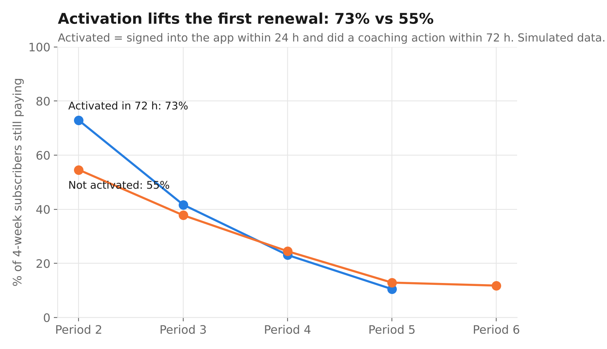
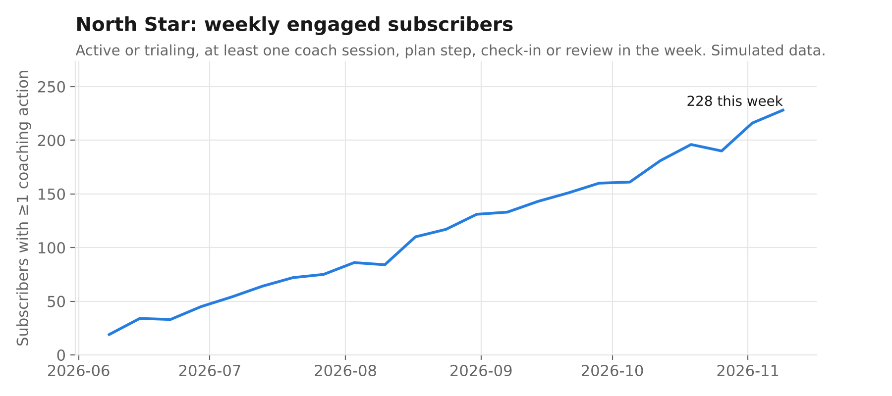

# Memo 3. Why subscribers leave, and the one lever that moves it

*Simulated data, June–November 2026. Server events `subscription_*`; app events joined on the same `$user_id`.*

## TL;DR

* **Not using the product is the #1 reason people cancel (53%)**, ahead of price (19%) and "not helpful" (17%). Churn here is an engagement problem before it is a pricing problem.
* **Activation is the lever.** We count a subscriber as activated if they sign into the app within 24 hours and do one coaching action within 72 hours. Activated 4-week subscribers renew into period 2 at **73% vs 55%**. Only **41%** of new subscribers activate today.
* **The 1-week plan is a trap.** Almost nobody is still paying at day 35 (0.6%), against 29% on the 4-week plan and 75% on the 12-week. It sells the cheapest first charge and loses the customer.
* **North Star (weekly engaged subscribers)** grew from about 20 to 220 a week over the period. It is the number to watch weekly; revenue follows it with a lag.

## Recommendations, in order

1. **Close the web → app gap.** 41% activation means more than half of paying users never start. Concrete steps:
   * a magic-link sign-in on the success page instead of "download the app";
   * the first coach message waiting in the app, continuing the funnel chat;
   * a 24-hour reminder email.

   Measure with the activation funnel `subscription_started → app_login (24 h) → coaching action (72 h)`.
2. **Retire the 1-week plan or reprice it.** Test the paywall without it. Expect a slightly lower first-charge conversion and a much higher D35 survival. Primary metric: net revenue per paywall viewer at D60.
3. **Pre-renewal nudge for low-engagement subscribers.** Send a "your plan for next week" message 3 days before renewal to anyone with no coaching action in the last 7 days. The reminder email is already promised on the paywall, so this costs nothing in trust.

## Notes

* The activated vs not curves converge after period 3: the early lift is clear (n = 108 vs 189 on 4-week plans), later points have few subscribers left.
* "Activated" is correlational here. Activation helps renewal, but motivated people also activate more. The causal check is to test an onboarding change (recommendation 1) and look at renewal in the treatment arm.
