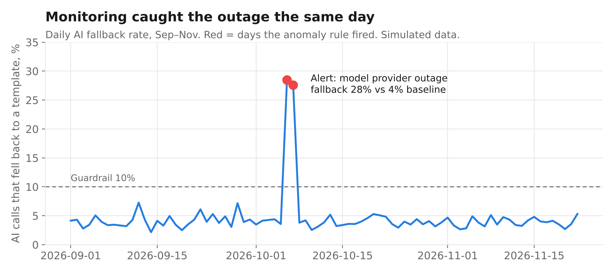

# Memo 4. Data you can trust: governance, migration, monitoring

*What an analytics team does so the other three memos are believable.*

## Tracking plan as code

* `analytics/tracking_plan.json` is the single source of truth: 48 events with trigger, source (web / server / app), owner, typed properties, and super and profile properties. [`TRACKING_PLAN.md`](../TRACKING_PLAN.md) and the CSV are generated from it.
* `scripts/tracking_plan.py validate <export>` checks any export against the plan: unknown events, missing required properties, wrong enum values, undocumented properties, possible PII (emails, phone numbers).
* Run on the 447K events of the earlier dataset, it found:
  * three events with old names;
  * super properties missing on 407K events;
  * a client-side purchase event that the plan had already deprecated.

  Run on the v3 dataset, the only finding is that deprecated event, which is expected: it fired during its migration window.

## A real bug the validator caught in the live funnel

A browser walk-through of the live funnel, checked against the plan, showed `situation_written` arriving in Mixpanel with **no properties at all**: no reason, no entry mode, not even the super properties.

The cause was the property name `length`. The Mixpanel JS SDK treats an object with a numeric `length` as an array and drops everything. Every situation event from the live site had been arriving empty, so the entry-mode experiment could not be split by `how` on live traffic.

The fix renames the property to `text_length`. The plan now notes why, so nobody reintroduces it.

## Revenue moved from the browser to the Stripe webhook

The old funnel recorded purchases from the success page. During the migration window (June 1 – July 15) both events ran side by side:

| | Server (`subscription_started`) | Client (`purchase_completed`) |
|---|---|---|
| Purchases | 146 | 137 events |
| Purchases missing on the client | — | 7.5% (ad blockers, closed tabs) |
| Duplicates | 0 (idempotent on Stripe event id) | 2 (page reloads) |
| Revenue | $2,806 | $2,709 (−3.5%) |

The client event under-counted revenue by 3.5%, and the error isn't random: users with ad blockers skew to some channels. The client event was then removed. Renewals, refunds, failed payments and cancellations are server-only. They never happen in a browser.

## Identity

* **Before email:** anonymous `$device_id`.
* **At email:** `identify(user_id)`, using Mixpanel's Simplified ID Merge, so the pre-email funnel joins the user.
* **Payments:** the same `user_id` and `device_id` travel in Stripe metadata, so webhook events land on the same person.
* **App:** the app calls `identify` with the same id after the magic-link sign-in, so web and app join (web2app).
* **Start fresh:** the demo link resets the identity *before* the first event. An earlier version reset it after the experiment exposure, which split one visitor into two ids.

## Monitoring

Mixpanel's alerts are a paid feature, so `scripts/alerts.py` runs the same idea on the export. For each daily rate metric:

* **Baseline:** the same weekday over the last 4 weeks.
* **Spread:** robust z-score, never below that day's sampling noise.
* **Fires at** |z| ≥ 4.

Over six months it fired on exactly the two real incidents and nothing else:

| Day | Metric | Value | Baseline | What happened |
|---|---|---|---|---|
| Sep 22 & 24 | Paywall reach after commitment, Android | 47%, 29% | 100% | Release bug: `paywall_viewed` not sent on Android. Purchases were fine; reports weren't |
| Oct 6–7 | AI fallback rate | 28% | 4% | Model provider outage: coach replies fell back to templates, and fewer people checked out that evening (the simulation assumes −18%) |

The Android one is the type that hurts most when nobody watches. Without an alert, the September paywall-conversion numbers would have shown a fake jump, because purchases stayed the same while paywall views disappeared.

## Environments and access

* Two Mixpanel projects: **Quietly (prod)** for the live site and **Quietly (dev)** for local and preview builds. Tokens come from env vars per Vercel environment.
* EU data residency.
* No names, emails or free text in events.
* Profiles hold only what the product uses.
